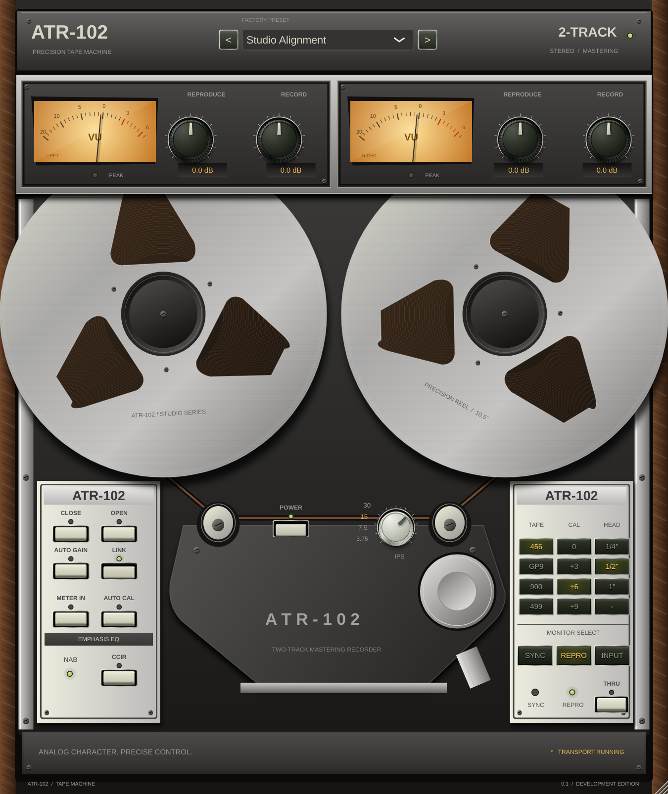

# ATR-102

A native, vector-drawn stereo tape plugin for VST3 hosts, with a standalone development application. The hardware interface features machined reel flanges, visible tape windings, moving analog meters, layered metal finishes, walnut cheeks, illuminated keys, and an opening calibration panel. No bitmap artwork, webview, or external assets are needed at runtime.



## Download packages

The available Linux VST3 ZIP is a development build. Extract it and copy the complete `ATR-102.vst3` directory into `~/.vst3/`, then rescan plugins in your DAW. It cannot be loaded on Windows or macOS.

The source ZIP includes `BUILD-WINDOWS.cmd`. On Windows, install Git, CMake 3.22+ and Visual Studio 2022 with the C++ desktop workload, MSVC v143 x64 and Windows SDK, then run that file. It builds and tests the plugin and creates `out/ATR-102-Windows-x64-VST3.zip`. This Windows helper has not been executed in the Linux cloud machine. The GitHub Actions workflow additionally runs both validators and builds an installer.

To reproduce the Linux package after building:

```sh
python scripts/package-vst3.py --bundle build/ReelGlue_artefacts/Release/VST3/ATR-102.vst3 --platform linux-x64 --output out/ATR-102-0.1.0-Linux-x64-VST3.zip
```

The package checks binary architecture and module metadata, includes installation notes and license notices, verifies ZIP contents, and writes SHA-256 checksums. See `docs/DSP_NOTES.md` for the remaining audio-model work.

## Build

Requirements: Git, CMake 3.22+, C++20, and Visual Studio 2022 on Windows. JUCE **8.0.15** and Catch2 **v3.5.4** are fetched from their official repositories. JUCE's licensing terms apply to distribution.

```powershell
cmake -S . -B build -G "Visual Studio 17 2022" -A x64
cmake --build build --config Release --target ReelGlue_VST3 ReelGlue_Standalone ReelGlueTests
ctest --test-dir build -C Release --output-on-failure
```

Linux requires ALSA, X11/Xext/Xinerama/Xrandr/Xcursor, FreeType, Fontconfig and OpenGL development packages. See `scripts/setup-cloud.sh` for the unprivileged cloud setup used in this workspace.

```sh
cmake -S . -B build -G Ninja -DCMAKE_BUILD_TYPE=Release
cmake --build build -j 3
ctest --test-dir build --output-on-failure
```

The VST3 bundle is produced under `build/ReelGlue_artefacts/Release/VST3/` on multi-configuration generators; the standalone application is in the sibling `Standalone/` directory.

The displayed product, host name and installable bundle are named **ATR-102**. Internal CMake targets and saved-state IDs retain their original names for compatibility.

## Controls

- Drag Record/Reproduce knobs; hold Shift for fine adjustment. Double-click resets. Knobs accept the mouse wheel and keyboard focus.
- Link uses the left channel as master. Auto Gain compensates Record with the inverse Reproduce gain.
- The three right-hand columns select formula slot, calibration and head width. Unavailable head widths are disabled at low speeds. The speed control selects 3.75 / 7.5 / 15 / 30 IPS.
- Open reveals the calibration and tape-circuit panel; Close hides it. Auto Cal replaces manual calibration; save your state in your host first.
- Click either reel to pause its animation. This does not stop audio.
- Thru or Power off selects latency-aligned dry audio, after a short transition.
- The preset selector and arrows recall twelve original factory settings. The host stores all parameter values with the session.

## Development status

This is a **development build**, not a validated release of the complete modeling specification in AGENTS.md. The implemented audio core supplies smoothed gains, flux-domain soft saturation, a resonant head bump, speed-dependent high-frequency loss, modulated tape delay, deterministic noise, crosstalk and state persistence. See [DSP notes](docs/DSP_NOTES.md) for the precise scope and remaining work, and [validation results](docs/VALIDATION.md) for executed checks. High/Eco currently share the normal core and are explicitly marked as previews in the UI.

Windows host/installer validation, calibrated Jiles–Atherton hysteresis, measured frequency-response/THD matching and the full long-duration test matrix remain release prerequisites. No claim of hardware-exact sound is made.
